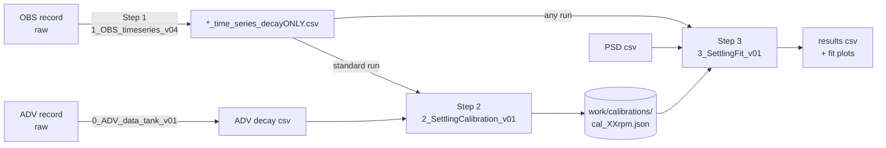

# 2. User guide: how to use the notebooks

This is a practical walk-through. The theory is in [01_theory.md](01_theory.md); every option is listed in [03_reference.md](03_reference.md).

## 2.1 The workflow at a glance



| Step | Notebook | How often |
|---|---|---|
| 1 | `1_OBS_timeseries_v04.ipynb` | every new OBS record |
| (ADV) | `0_ADV_data_tank_v01.ipynb` | every ADV record used for a calibration |
| 2 | `2_SettlingCalibration_v01.ipynb` | **once per mixer rotation rate** (and tank setup) |
| 3 | `3_SettlingFit_v01.ipynb` | every set of runs |

Most users do step 1 and then step 3, using a calibration file that already exists for their mixer rate.

## 2.2 Installation

```bash
git clone https://github.com/FluidSedDynamics/TankSettling.git
cd TankSettling
pip install -r requirements.txt
python tools/setup_work.py     # creates work/
jupyter lab                    # or jupyter notebook
```

Developed and tested with Python 3.13, numpy 2.5, scipy 1.18, pandas 3.0 and matplotlib 3.11; other recent versions are likely to work but are untested.

**The `work/` folder.** `python tools/setup_work.py` creates `work/` from `work_template/` and the template notebooks: your own copies of the four notebooks, and the folders `data_OBS/`, `data_ADV/`, `data_PSD/`, `calibrations/` and `results/` with the sample data in them. Process data in the notebooks inside `work/`. The first cell of every notebook finds the project folder, imports the code from `tools/`, and changes into `work/`, so **all file paths in the notebooks and in this guide are relative to `work/`** (`data_OBS/` means `work/data_OBS/`). A template opened from the project folder behaves the same way, and creates `work/` on first run if needed.

`work/` is ignored by git, so nothing you process is ever committed and `git pull` never conflicts with it. Keep as many copies of a notebook in `work/` as you like, for example one step 1 notebook per record; the saved copy records the inputs you chose and the plots you chose them from. `git pull` updates `tools/` for all your notebooks. Updated *template notebooks* do not replace your copies: rerun `python tools/setup_work.py`, which adds new files but never overwrites (rename your copy first if you want the new version under the same name). More in `work/README.md`.

**If you will change code and push it,** run `pip install nbstripout` and then `nbstripout --install` once in your clone. Git then stores notebooks without their outputs, so editing a template does not commit plots or printed results.

**Quick check that everything works.** `work/` starts with one raw sample of each record, `data_OBS/MicroSphere_75_90_SAMPLE.csv` (a 75–90 µm standard) and `data_ADV/raw/ADV_02_60rpm_SAMPLE.dat` (60 rpm), a calibration file made from them (`calibrations/cal_60rpm.json`) and example PSD files in `data_PSD/`. The notebooks are set up to use these samples, so you can run the ones in `work/` in order without changing any input:

1. `0_ADV_data_tank_v01.ipynb` writes `data_ADV/filtered/ADV_02_60rpm_SAMPLE_filtered_decay_only.csv` (only needed to re-run step 2);
2. `1_OBS_timeseries_v04.ipynb` writes `data_OBS/MicroSphere_75_90_SAMPLE_time_series_decayONLY.csv`;
3. `2_SettlingCalibration_v01.ipynb` (optional) rewrites `calibrations/cal_60rpm.json` with the same values;
4. `3_SettlingFit_v01.ipynb` fits the sample in about a minute and reports a density of about 1198 kg m⁻³ for the 75–90 µm standard.

## 2.3 Data you need

| What | Where it comes from | Used for |
|---|---|---|
| OBS decay csv (columns `sec`, `NTU`, `Co_NTU_avg`, `Cbackground_NTU_avg`) | Step 1 notebook, the `*_time_series_decayONLY.csv` file | steps 2 and 3 |
| ADV decay csv (columns `decay_time_s`, `v1_m_s`, `v2_m_s`, `v3_m_s`) | `0_ADV_data_tank_v01.ipynb` notebook, the decay dataframe saved to csv | step 2 only |
| PSD csv for each unknown run | your particle sizing | step 3 |
| Standard's size range and density | the manufacturer or your own measurement | step 2 |
| Tank geometry, water temperature and salinity | your records | steps 2 and 3 |

Time (`sec`) must be seconds **since the mixer was switched off** (t = 0 at the end of stirring) and the record should contain only the decay. `Co_NTU_avg` is the initial (mixer-on) concentration and `Cbackground_NTU_avg` is the value the OBS reads when settling has finished; both are taken from the first row. The remaining columns in the Step 1 csv (date-time, running time, mg/L) are ignored by the fit notebooks.

PSD csv example (one row per size bin; amount can be mass %, volume % or a fraction):

```csv
diameter_um,percent
75.0,6.25
76.0,6.25
...
```

Cumulative "percent finer" tables also work (`p_type='cumulative'`). A **single size** is a csv with one row.

## 2.4 Step 1: prepare an OBS record

Open `1_OBS_timeseries_v04.ipynb`. It turns one raw OBS logger file into the decay-only csv that steps 2 and 3 read. The notebook's plots are interactive (`%matplotlib widget`), which needs the `ipympl` package; zoom in on them to read off times.

The raw file is the logger's csv export (TOA5 format: four header lines, then one row per minute with a timestamp, a record number and one NTU value per sample). Put it in `work/data_OBS/`; if the logger wrote a different extension, rename it to `.csv`.

1. **Pick the file.** The file cell lists every csv in `data_OBS/` with an index. `j` selects the sample by name; change the name to your record, or set `j` to its index. The list also shows the notebook's own outputs (`*_time_series.csv`, `*_time_series_decayONLY.csv`), so make sure you pick the raw file.
2. **Correct the start time if needed.** `hr_cor`, `min_cor` and `sec_cor` are added to the logger's first timestamp. The logger time on each row is the time of the *last* sample in that row, which the default correction (−1 min + 2 s, for 2 s sampling) accounts for.
3. **Check the time series plot.** The notebook stacks the samples into one series in seconds from the start of the record and saves it as `<name>_time_series.csv`.
4. **Set the averaging windows and the mixer-off time** from that plot (all in seconds on its time axis):
   * `Co_start_s`, `Co_end_s`: a window while the mixer runs and the concentration is steady; its mean is $C_o$;
   * `Cbackground_start_s`, `Cbackground_end_s`: a window after settling has finished; its mean is $C_{background}$;
   * `mixer_off`: when the mixer was switched off. This is the critical value: it sets t = 0 for steps 2 and 3. Give it directly, or as `mixer_on` plus the mixing time (e.g. `mixer_off = mixer_on + 4*60`).
   The check plot shows both averages and the mixer on/off lines.
5. **Run the trim cell.** It keeps only the data after `mixer_off`, adds `sec` (time since mixer off) and the two averages, and saves `<name>_time_series_decayONLY.csv`. This is the file steps 2 and 3 use.
6. **Optional: convert to mg/L.** Enter the calibration slope `m` and intercept `b` ($C_{mass} = m\,C_{NTU} + b$). The last cell adds mg/L columns to both csv files. The fits do not use them.

## 2.5 Step 2: calibrate the turbulence (once per mixer rate)

Open `2_SettlingCalibration_v01.ipynb`.

1. **Set the input cell.** File names for the standard's OBS csv and the matching ADV csv (`adv_file = None` if you have no ADV record for this mixer rate); the rotation rate (`rpm`); tank geometry (water depth and sensor height above the bottom, in inches); water temperature and salinity; the settling-law coefficient (`coef`); the standard's size range, number of size classes and density. Both turbulence models are calibrated, the ADV shape and the exponential; without an ADV record only the exponential is. `default_model` (`'adv'`) is the one step 3 uses unless told otherwise. Leave the other turbulence options at their defaults unless you have a reason to change them. The output goes to `calibration_file`, for example `calibrations/cal_60rpm.json`; use a name that includes the mixer rate.
2. **Run the notebook from the top.** It takes about three minutes with both models, most of it the density tables.
3. **Check the ADV shape plot** (when there is an ADV record). The fluctuation variance should fall from a high value to a roughly flat noise floor within 20–35 s, and the noise-floor line should sit on that flat part. The shape should start at 1 and decay smoothly to zero. If the record is too short for the noise floor to be estimated from after 60 s, lower `adv_noise_from_s`; if the record starts with a weak spin-up window, set `adv_normalize = 'max'`.
4. **Check the fit.** Both models are drawn against the data and should follow it through the whole decay; similar rms values (as on the sample) mean the OBS decay alone cannot choose between them. Residuals of about 0.04 are sensor noise; a larger rms (the 75–90 µm standard gives 0.08) or residuals with a visible pattern mean something systematic remains, and the density or size distribution assumed for the standard is the first suspect. Record the lag-1 autocorrelation (about 0.4 is typical).
5. **Read the K0 vs density tables** (one per model). K0 changes strongly with the density you assumed for the standard. The spread over ±50 kg m⁻³ is the realistic uncertainty of K0; it is stored in the calibration file and should guide the `K0_factor` you use in step 3.
6. **Check that the file was written.** The "Save" cell prints the stored K0, Kmin, rate and geometry of each model.
7. **Optional but recommended: test on a second standard.** Set `validate = True` and give a second standard of different size or density (its OBS csv, size range and density). The notebook predicts its decay with each stored model and no refit. A prediction rms close to the noise level (about 0.04) means the calibration transfers between particle sizes.

Repeat this step when the mixer rate, tank, water depth or sensor position changes. Different mixer rates need different calibration files, each with its own ADV file (or none, for an exponential-only calibration).

## 2.6 Step 3: fit settling velocity (any number of runs)

Open `3_SettlingFit_v01.ipynb`.

1. **Choose the calibration file** (`calibration_file`) that matches the mixer rate and tank setup of your runs, and set `rpm` so the notebook can check it. Tank geometry comes from the file. If the water depth, sensor height or rate differs from the calibration, the notebook prints a `WARNING`; fix the input or recalibrate rather than ignoring it.
2. **List the runs.** Each run is one entry in `runs` with a `name`, an `obs_file` (the Step 1 csv) and a `psd_file`:

   ```python
   runs = [
       dict(name='run 07, quartz', obs_file='data_OBS/run07_time_series_decayONLY.csv', psd_file='data_PSD/run07_PSD.csv'),
       dict(name='run 08, flocs',  obs_file='data_OBS/run08_time_series_decayONLY.csv', psd_file='data_PSD/run08_PSD.csv',
            what_to_fit='nf', coef=1, rhos_for_nf=2650.0, dp_um=8.0, T_C=12.0, S_ppt=0.5),
   ]
   ```

   Anything set in the defaults block can be overridden for a single run by adding it to that run's entry.
3. **Choose the turbulence model** (`turb_model`): `'adv'` (ADV shape), `'exp'` (exponential), or `None` for the default stored in the calibration file. A file calibrated without an ADV record holds only `'exp'`. To see how much the model matters, list a run twice with different `turb_model` values; `turb_model` is a column of the results table.
4. **Choose what to fit** (`what_to_fit`):
   * `'rhos'` for solid particles of unknown density (set `nf = 3`, the default);
   * `'nf'` for flocs of unknown fractal dimension (set `rhos_for_nf` and `dp_um`, and usually `coef = 1`);
   * `'ws50'` for the settling velocity at the median size without any density or fractal-dimension assumption (set `beta`).
5. **Set the settling-law coefficient** (`coef`) for the type of particle (see the reference), and the water temperature and salinity of each run.
6. **Run the notebook.** Each run takes about 25 s with the K0 sensitivity fits, about 10 s without (`do_sensitivity = False`).
7. **Inspect the plots** (shown in the notebook and saved in `results/fit_plots/`). The model should follow the data; look at the residuals for a pattern. The rms is printed for each run.
8. **Read the results table** (also written to `results/SettlingFit_results.csv`):
   * `value` and `sigma`: the fitted density (kg m⁻³), fractal dimension, or velocity (mm s⁻¹) and its fit uncertainty;
   * `value_K0_low` and `value_K0_high`: the fitted value with K0 divided and multiplied by `K0_factor`; if these differ from `value` by much more than `sigma`, the turbulence calibration dominates the uncertainty and `sigma` alone should not be quoted;
   * `w50_mm_s` and its range, `w_mean_mm_s` (mass-weighted mean velocity) and `d50_um`: the settling velocity itself, regardless of mode;
   * `rms` and `rho1`: fit quality and residual autocorrelation.

## 2.7 Typical situations

| Situation | What to do |
|---|---|
| New mixer rotation rate | Run the ADV notebook at that rate, then step 2 with a standard run at that rate. New calibration file. |
| New tank, water depth or sensor position | New calibration (step 2). The notebook warns if the geometry differs. |
| New water temperature or salinity only | No new calibration; set `T_C` and `S_ppt` per run in step 3. |
| Different standard available | Run step 2 with the new standard; use `validate = True` on the other one. |
| Single particle size | Use a PSD file with one row. |
| Flocs | `what_to_fit = 'nf'`, `coef = 1`, `rhos_for_nf` = primary particle density, `dp_um` = primary particle size; the PSD must be the floc size distribution during the run. |
| PSD measured by mass or volume and sensor response differs by size | Set `gain_exp` (about 1 for backscatter per unit mass from coarse particles). |
| Fit dominated by early noise or late background | Restrict the fit window with `t_fit_start` and `t_fit_end`. |
| Quick scan with many runs | `do_sensitivity = False`, then repeat the final runs with it on. |

## 2.8 Quality checks before you use a number

* The calibration file's geometry and rate match the run (no `WARNING`).
* `rms` of the run is close to the calibration's rms. A much larger value means the run does not behave like the standard (different mixing, different concentration, a wrong PSD).
* Residuals do not trend with time.
* `value_K0_low` and `value_K0_high` bracket the fit; quote the wider of the two ranges with the fit's `sigma`.
* The fitted value is not at a bound (nf = 3.0 or 1.2, excess density at 1 or 6000 kg m⁻³, velocity at the limits in the reference). A value at a bound means the data and the assumed size, density or `coef` are inconsistent.
* The PSD, not just `d50`, is right: the shape of the decay depends on the whole distribution.

## 2.9 Using the code from a script

Everything the notebooks do is available from `tools/settling_tools.py`. From a script run in `work/` (so the data paths match the notebooks), add `tools/` to the import path first:

```python
import sys
sys.path.insert(0, '../tools')
import settling_tools as ss

cal = ss.load_calibration('calibrations/cal_60rpm.json')
for msg in ss.check_calibration(cal, cal['geom'], rpm=60):
    print('WARNING:', msg)

row, fit, data = ss.fit_run('data_OBS/run07_time_series_decayONLY.csv', 'data_PSD/run07_PSD.csv', cal['geom'], cal,
                            T=19.4, S=0.0, coef=5, what='rhos', K0_factor=1.4)
print(row['value'], row['sigma'], row['w50_mm_s'])
```

## 2.10 Troubleshooting

| Message or symptom | Cause and remedy |
|---|---|
| `FileNotFoundError: could not find the project folder` | The notebook is not inside the project folder or its `work/` folder (or more than three folder levels below it). Move it into `work/`. |
| `ModuleNotFoundError: settling_tools` (in a script) | Add `tools/` to the import path, as in section 2.9. |
| `FileNotFoundError` for a csv | Paths in the input cells are relative to `work/`, not to the folder the notebook is in. |
| `KeyError: 'sec'` (or `NTU`) | The OBS csv does not have the Step 1 columns; use the `*_time_series_decayONLY.csv` file, or pass other column names through `load_kw` in `fit_run`. |
| `WARNING: … differs from the calibration` | Geometry or mixer rate does not match the file; correct the input or recalibrate. |
| `ValueError: ADV record too short…` | The ADV record is shorter than `adv_noise_from_s`. Lower it or pass `adv_noise`. |
| `ValueError: no turbulence above the noise floor in the first window` | The ADV record does not show a decaying signal; check that it starts at mixer-off. |
| `is not a settling calibration file` | `calibration_file` points to the wrong file. |
| `has no 'adv' calibration (it was calibrated without an ADV record)` | The calibration file holds only the exponential model; set `turb_model = 'exp'` (or `None`), or recalibrate with an ADV record. |
| Fitted density is NaN, or a parameter sits at a bound | The fitted velocity is outside what the settling law gives for that size; check `d`, `coef`, `nf`, the PSD diameters (µm, not mm) and the OBS record. |
| Residuals large, one sign for long stretches | Wrong standard density or PSD, wrong geometry, or a sensor or mixer setup different from the calibration. |
| Slow | Fewer classes (`n_max_classes`), `do_sensitivity = False`, or a smaller `N` while exploring. |
